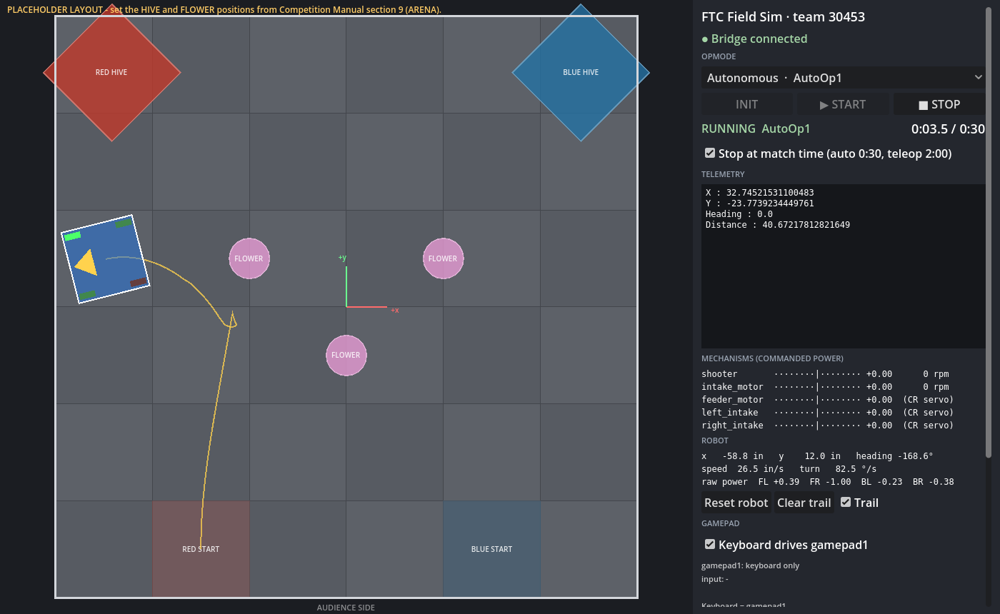

# FTC Field Sim (team 30453)



A 2D field simulator that runs your **real TeamCode OpModes, unchanged**, on a laptop.

```
 Simulator/
 ├─ godot/     Godot 4 app: field, robot physics, gamepad, Driver Station panel
 └─ bridge/    Java: compiles ../../TeamCode against stand-in FTC SDK classes and runs your OpModes
```

The two halves talk over `127.0.0.1:7777`. Godot simulates the robot and sends encoder ticks, IMU heading and gamepad input. The bridge runs your OpMode and sends back motor and servo power, telemetry, and errors.

## Setup (once)

1. Put this `Simulator` folder in the root of the robot repo, next to `TeamCode/`.
2. Install **Godot 4.4 or newer** (standard version, not .NET) from godotengine.org.
3. You need a **Java JDK 17+**. If Android Studio is installed you already have one: the scripts find Android Studio's bundled `jbr`. Otherwise set `JAVA_HOME`.

## Every session

1. Open Godot, choose **Import**, pick `Simulator/godot/project.godot`, and press **F5** (Run).
2. Start the bridge:
   - Windows: double-click `Simulator/bridge/run-bridge.bat`
   - Mac/Linux: `./Simulator/bridge/run-bridge.sh`
3. In the sim window, pick an OpMode, then press **INIT**, then **START**, like on the Driver Station.

**After changing code:** close the bridge (Ctrl+C) and run it again. It recompiles. The Godot window can stay open and reconnects on its own.

Compile errors and exceptions show up in the bridge console and in the sim's Log and Telemetry panels.

## Driving

In the **Gamepad** section of the panel, choose what drives **gamepad1** and **gamepad2**:

- **Keyboard**
- **Gamepad N**: a specific USB or Bluetooth controller
- **Keyboard + Gamepad N**: both at once
- **Nothing**

By default gamepad1 is the keyboard plus the first controller, and gamepad2 is the second controller. Your choice is remembered, even if you unplug and replug a controller. The keyboard only works while the sim window has focus. Logitech F310/F710: set the switch on the back to **X**.

| Keys | Gamepad |
|---|---|
| W A S D | left stick |
| Q / E | right stick X (turn) |
| R / F | right stick Y |
| Arrow keys | D-pad |
| I J K L | Y X A B |
| U / O | left / right bumper |
| Z / C | left / right trigger |
| Shift (hold) | half stick |

Before INIT, you can drag the robot to set its starting spot and use the mouse wheel to rotate it (Shift turns 1° at a time). **Reset robot** returns it to `start_pose`.

## What it simulates (and how it catches bugs)

- **Motor direction like a real robot.** Right-side motors are mounted mirrored (`"mirrored": true` in `robot.json`). Code that forgets `setDirection(REVERSE)` spins in place instead of driving straight, and its encoders count backwards.
- **Encoders** follow the motor shaft (ticks per rev and max rpm per motor). `STOP_AND_RESET_ENCODER`, `RUN_TO_POSITION` (including the "set a target first" exception), and `setVelocity`/`getVelocity` work.
- **IMU mounting.** `robot.json` `"hub"` says how the hub is physically mounted. If the orientation passed to `imu.initialize()` disagrees, the yaw is wrong the same way it would be on the robot (reversed, or stuck at 0), and the Log explains why.
- **Hardware names.** Asking `hardwareMap` for a name or type that isn't in `robot.json` throws the same error a real robot does.
- **Telemetry** only appears on `update()`, auto-clears, and refreshes every 250 ms, like the Driver Station.
- **STOP** interrupts the OpMode. If your loop ignores `opModeIsActive()`, the sim reports "stuck in stop", as the real app does.
- **Walls and solid field elements** block the robot, so the outline turns orange on contact. Distance and touch sensors are supported (see `_sensor_examples` in `robot.json`).
- **Match timer:** auto stops at 0:30 and teleop at 2:00. You can turn this off.

## Not simulated (yet)

- Game pieces (POLLEN and NECTAR). The shooter, intake and servos show their commanded power in the Mechanisms panel, but nothing gets picked up or launched.
- Cameras, AprilTags, VisionPortal, color sensors, odometry pods (Pinpoint, dead wheels), and RoadRunner or Pedro Pathing. The bridge only provides the SDK classes listed in `bridge/src/main/java`. Code that imports others won't compile until a stand-in is added.
- Wheel slip, weight transfer, and battery sag. The drive model is idealized mecanum with motor lag.

## Configure your robot and field

- `godot/config/robot.json` holds device names, types and motor specs, plus robot size, wheel diameter, track width, wheelbase, hub mounting and start pose. **Measure track width and wheelbase on your robot**, because the defaults are guesses.
- `godot/config/field.json` holds field elements. **The current BIOBUZZ layout is a placeholder.** Set the HIVE and FLOWER positions and sizes from Competition Manual section 9 (ARENA). The coordinate system has its origin at the field center, +x to the right, +y away from the audience, in inches.

## Headless runs (no window)

You can use these for a quick check or in CI. Start the bridge first, then run:

```
godot --headless --path Simulator/godot -- --opmode AutoOp1 --seconds 30 --trace auto.csv
godot --headless --path Simulator/godot -- --opmode "Manual Control" --seconds 2 --input left_stick_y=-1
```

Options:
- `--pose x,y,heading` sets the start pose.
- `--input name=value,...` holds gamepad1 inputs during the run. Use FTC names such as `right_trigger=1` or `a=1`.
- `--screenshot out.png --screenshot-at 4` saves a screenshot (needs a window, not `--headless`).

The run prints pose and telemetry, then exits with code 0 if OK, or 1 if the OpMode threw an error.

## How the bridge works

`bridge/src/main/java` contains classes with the same package and class names as the FTC SDK, such as `com.qualcomm.robotcore.hardware.DcMotor`, `LinearOpMode` and `Telemetry`. Your TeamCode compiles against them without edits. `OpModeRegistry` finds every `@TeleOp` and `@Autonomous` class (skipping `@Disabled`), just as the Driver Station list does.

To support another SDK class, add a stand-in with the same package and name.
